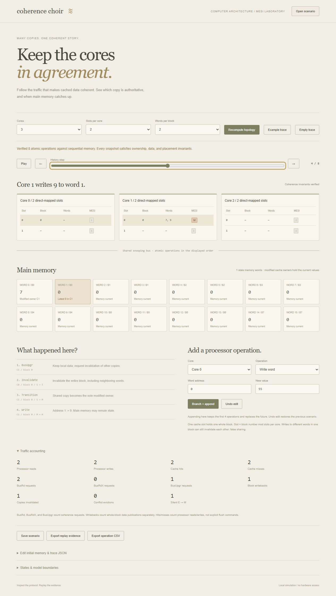

# Coherence Choir

A browser laboratory for MESI cache coherence. Rewind a processor trace, inspect dirty owners and stale memory, branch the history, and measure false sharing by changing the block size.



## Run

Requires Python 3.10+; no runtime packages or build step.

```sh
python run.py --port 8000
```

Open http://127.0.0.1:8000. The server binds to loopback and serves only application assets. Simulation and file processing stay in the browser.

## Explore

- Step through read, write, and flush operations, or play the trace automatically.
- Inspect every direct-mapped slot, MESI state, block tag, and cached word. Memory cards identify modified owners and stale values.
- Follow ordered bus requests, invalidations, interventions, evictions, and writebacks.
- Change cores, slots, and block size; recompute the same workload to expose false sharing and conflict misses.
- Append at the current step to branch history; undo up to 30 scenario edits.
- Import/export scenarios, export complete replay evidence, or download cumulative operation traffic as CSV.

The included [example](docs/example.json) has eight operations. With two words per block it produces two invalidations and two BusUpgr requests. With one word per block both counts become zero. Final memory contains 11 at address 0, 9 at address 1, and 42 at address 4.

## Model

This is an atomic snooping MESI model with write-back, write-allocate, direct-mapped caches. Read misses use BusRd; write misses use BusRdX; writes to shared copies use BusUpgr. Exclusive writes become modified silently. Modified interventions publish the whole block to memory before sharing or ownership transfer. Explicit flush changes M to E and retains the copy. Writeback counts are separate from coherence request counts.

After every operation, the engine checks exclusive ownership, agreement with sequential reference memory, clean-copy consistency, and slot placement. Execution clones its input state, making replay snapshots independent. A web worker keeps simulation off the UI thread.

Bounds: 2–4 cores, 1/2/4 slots per core, 1/2/4 words per block, 4–32 memory words, and 200 operations. Values are integers from −999999 through 999999. Memory length must be divisible by block size.

This educational model does not simulate transient protocol states, bus races, timing, store buffers, speculative execution, multilevel caches, or programming-language memory models. It does not inspect real hardware or estimate processor performance.

## Verification

Node.js 22+ runs the engine suite; Python exercises the static server.

```sh
npm test
npm run check
python -m unittest discover -s tests -p "test_*.py"
```

Tests cover MESI transitions, dirty eviction, whole-block preservation, false sharing, immutable snapshots, validation, and 120 deterministic randomized histories totaling 24,000 operations. Each history is checked against sequential memory and flushed to verify final memory. GitHub Actions runs Linux and Windows checks.

Browser checks cover rewind, branch/undo, block-size comparison, playback completion, scenario import, and all exports. An independent Python check verified all nine example snapshots, ownership, logical reads, clean data, and eight CSV rows.

## References

The protocol vocabulary and coherence principles follow Carnegie Mellon's [cache coherence lecture](https://www.cs.cmu.edu/afs/cs/academic/class/15418-s21/www/lectures/11_cachecoherence1.pdf) and [MESI discussion](https://www.cs.cmu.edu/~418/lectures/10_cachecoherence.pdf). The specific simplifications above define this simulator's behavior.
